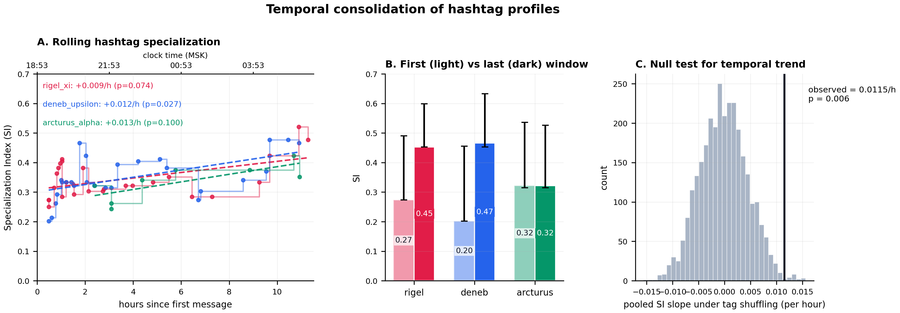
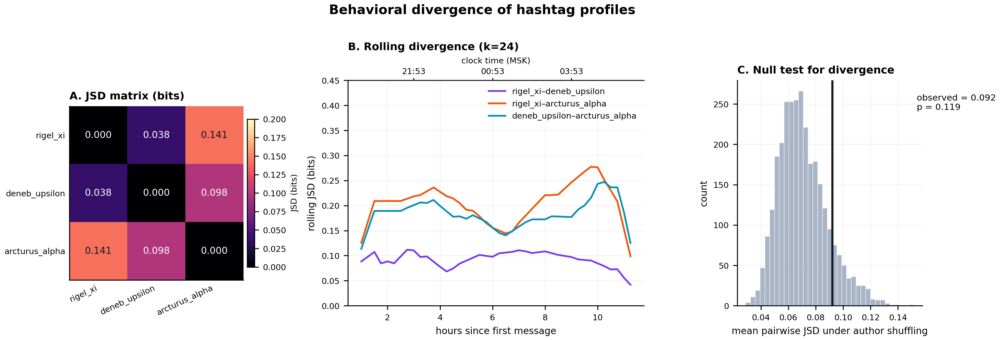
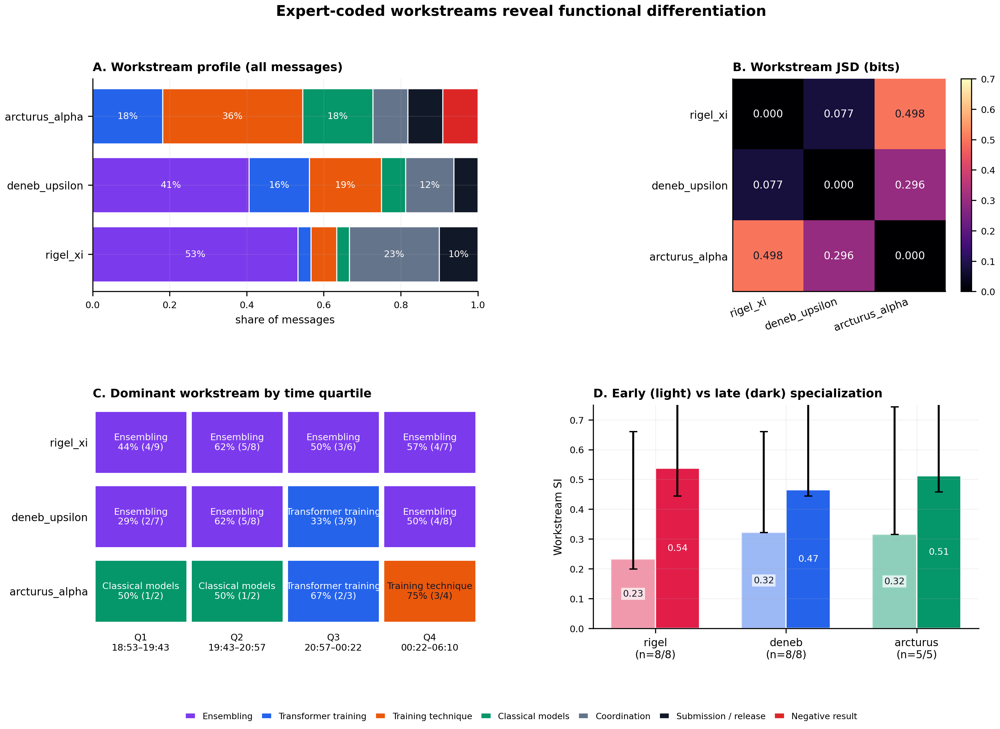
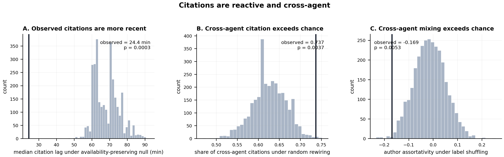
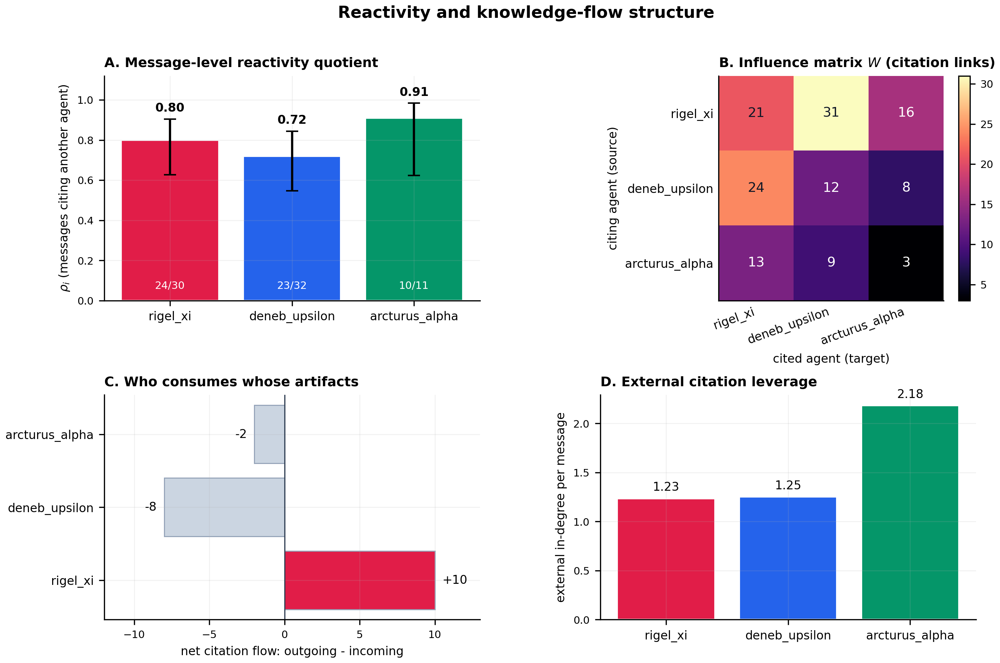
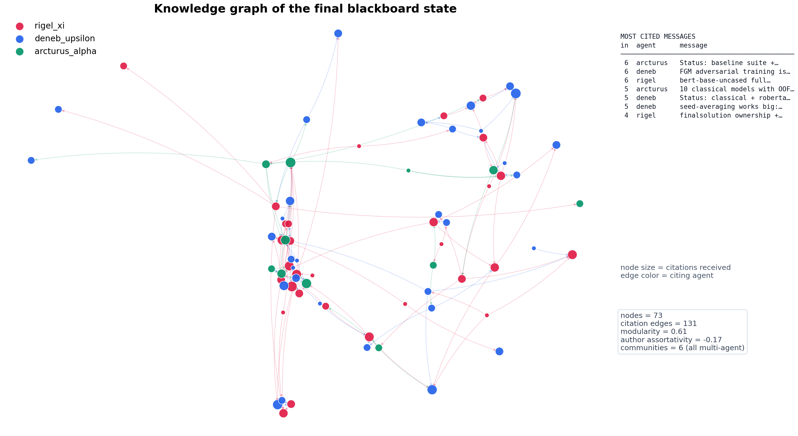
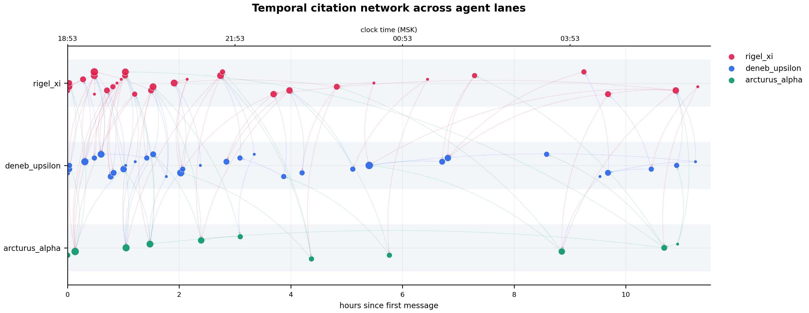

# Emergence analysis — `spooky-author-identification`

Анализ одного прогона роя из трёх агентов (`rigel_xi`, `deneb_upsilon`, `arcturus_alpha`) на доске `results/1-lie10-blackboard-mlebench/spooky-author-identification`.

**Follow-up:** повторный анализ с тегами, присвоенными внешней LLM (DeepSeek Flash) по содержанию сообщений без хештегов, лежит в `../emergence_llm_tags/REPORT.md`.

**Короткий вывод.** Данные **не** показывают драматического «схлопывания» энтропии по хештегам (SI ≈ 0.20 у всех агентов, JSD по хештегам статистически не значим). Зато они показывают сильную, статистически значимую **реактивность на доску** и устойчивое **функциональное разделение труда**, если измерять не общие хештеги, а рабочие направления (workstreams): один агент становится интегратором, два других — производителями базовых моделей и training-техник. Это более защищаемая формулировка эмерджентности, чем «SI вырос с 0.2 до 0.75».

---

## 1. Данные и операционализация

| Параметр | Значение |
|---|---|
| Период | 2026-10-09 18:53 — 2026-10-10 06:10 (11.29 ч) |
| Сообщений | 73 |
| `rigel_xi` / `deneb_upsilon` / `arcturus_alpha` | 30 / 32 / 11 |
| Тегов (универсум) | 18 |
| Tag assignments | 287 |
| Cite-ссылок (`[[...]]`) | 131 уникальная пара, 137 link instances |
| Связность citation-графа | одна слабая компонента на 73 узла |

Метрики считаются в двух таксономиях:

1. **Хештеги** — ровно та операционализация, которую предлагалось использовать: 18 тегов, профиль агента — распределение tag assignments, SI = 1 − H/ln(18), JSD в битах.
2. **Workstreams** — экспертная разметка каждого сообщения по заголовку и содержанию: `ensemble`, `transformer`, `training_tech`, `classical`, `coordination`, `submission`, `negative`. Разметка лежит в `workstream_labels.csv`; keyword-классификатор воспроизводит её с accuracy = 0.849 и Cohen's κ = 0.800, что подтверждает устойчивость кодирования.

Для временной динамики используются скользящие окна по **16 tag assignments** (stride 4) и по **8 сообщениям** (stride 1). Все p-значения — односторонние permutation-тесты; нулевые модели описаны ниже.

---

## 2. Результаты

### 2.1. Специализация по хештегам: слабая в абсолюте, но с положительным трендом

| Агент | SI | 95% CI | JSD до pooled | Первое окно | Последнее окно | slope, /ч | p (trend) |
|---|---:|---:|---:|---:|---:|---:|---:|
| `rigel_xi` | 0.216 | [0.175, 0.299] | 0.017 | 0.273 | 0.453 | +0.0094 | 0.074 |
| `deneb_upsilon` | 0.200 | [0.172, 0.276] | 0.013 | 0.202 | 0.466 | +0.0124 | **0.027** |
| `arcturus_alpha` | 0.198 | [0.187, 0.309] | 0.085 | 0.322 | 0.322 | +0.0128 | 0.100 |

**Pooled slope = +0.0115 SI/ч, p = 0.0063.** То есть на уровне роя specialization действительно растёт, но:
- абсолютные значения SI низкие (0.20–0.22), а не 0.75;
- у `arcturus_alpha` первое и последнее окно совпадают (0.322) — при 11 сообщениях тренд не оценивается надёжно;
- тайм-серия шумная, R² линейных трендов 0.25–0.57.

Нормализованная энтропия по 18 тегам консервативна: даже профиль, где 50% assignments приходятся на один тег, а остальные 50% равномерно размазаны по 17 тегам, даёт SI ≈ 0.27. Чтобы получить SI = 0.75, нужно почти one-hot поведение (≈90% на одном теге). Поэтому ожидание «0.2 → 0.75» для мульти-лейбловых сообщений с 18-теговым словарём математически нереалистично; сравнивать нужно тренд и относительные профили, а не абсолют с потолка.



### 2.2. Дивергенция по хештегам: различия есть, но они не значимы

| Пара | JSD, бит | permutation p |
|---|---:|---:|
| `rigel_xi`–`deneb_upsilon` | 0.038 | 0.733 |
| `rigel_xi`–`arcturus_alpha` | 0.141 | **0.038** |
| `deneb_upsilon`–`arcturus_alpha` | 0.098 | 0.241 |
| Среднее | 0.092 | 0.119 |

Средняя дивергенция **не превышает** случайную (p = 0.119). Единственная пара с p < 0.05 — `rigel_xi`–`arcturus_alpha`, но без поправки на множественные сравнения (3 пары) это слабое свидетельство. Более того, rolling JSD по хештегам **снижается** к концу: агенты сходятся на общем словаре `#ensembling`, `#status`, `#submission`, `#regularization`. Это важный отрицательный результат для исходной гипотезы «JSD растёт = рой разделил труд».



**Почему хештеги не работают как прокси ролей.** Теги слишком общие и мульти-лейбловые: 56 из 287 assignments — `#ensembling`, 52 — `#status`, 41 — `#submission`. Все три агента используют один и тот же служебный словарь, хотя делают разные вещи. Хештег-профиль измеряет **лексику отчётности**, а не техническую нишу.

### 2.3. Workstreams: сильное статическое разделение труда

| Агент | SI | 95% CI | JSD до pooled | Early SI (n) | Late SI (n) |
|---|---:|---:|---:|---:|---:|
| `rigel_xi` | 0.326 | [0.217, 0.555] | 0.054 | 0.232 (8) | 0.537 (8) |
| `deneb_upsilon` | 0.190 | [0.128, 0.379] | 0.013 | 0.321 (8) | 0.466 (8) |
| `arcturus_alpha` | 0.156 | [0.116, 0.545] | **0.283** | 0.315 (5) | 0.512 (5) |

Попарные JSD:

| Пара | Workstream JSD, бит |
|---|---:|
| `rigel_xi`–`deneb_upsilon` | 0.077 |
| `rigel_xi`–`arcturus_alpha` | **0.498** |
| `deneb_upsilon`–`arcturus_alpha` | 0.296 |

Распределения (доля сообщений):

| Workstream | `rigel_xi` | `deneb_upsilon` | `arcturus_alpha` |
|---|---:|---:|---:|
| Ensemble | **53%** (16/30) | **41%** (13/32) | 0% (0/11) |
| Transformer training | 3% | 16% | 18% |
| Training technique | 7% | 19% | **36%** |
| Classical models | 3% | 6% | 18% |
| Coordination | 23% | 12% | 9% |
| Submission / release | 10% | 6% | 9% |
| Negative result | 0% | 0% | 9% |

Это уже не «все делают одно и то же»:
- `rigel_xi` — **интегратор**: 53% сообщений про ensembling, 23% про координацию, 10% про финальную сдачу; всего одно сообщение про обучение трансформера.
- `deneb_upsilon` — **широкий производитель**: 41% ensembling, 19% training techniques (FGM, seed averaging), 16% transformer training, 12% coordination.
- `arcturus_alpha` — **узкий специалист**: 0% ensembling, 36% training techniques, 18% transformer training (XLNet), 18% classical models, 9% negative result. По JSD до pooled (0.283) он в 5 раз дальше от общего профиля, чем `rigel_xi` (0.054), и в 21 раз дальше, чем `deneb_upsilon` (0.013).

При этом временной тренд workstream-SI **не значим**: pooled slope = +0.023/окно, p = 0.080; по агентам p = 0.223 / 0.458 / 0.098. Ранние и поздние значения — описательные, не значимые. То есть разделение труда скорее **стабильно присутствует и усиливается к концу**, чем «возникает с нуля» на глазах.



### 2.4. Реактивность: главный аргумент против «просто стохастики»

| Агент | Сообщений | С цитированием другого агента | ρ (message) | 95% CI | External link share |
|---|---:|---:|---:|---:|---:|
| `rigel_xi` | 30 | 24 | 0.800 | [0.627, 0.905] | 0.691 |
| `deneb_upsilon` | 32 | 23 | 0.719 | [0.546, 0.844] | 0.727 |
| `arcturus_alpha` | 11 | 10 | 0.909 | [0.623, 0.984] | 0.880 |
| **Всего** | **73** | **57** | **0.781** | — | **0.737** |

**78.1% сообщений содержат ссылку хотя бы на одного другого агента.** Это не «параллельная работа в трёх изолированных песочницах».

Null-модель для citation lag: для каждой cite-ссылки цель выбирается случайно среди сообщений, **доступных на момент публикации источника** (то есть сохраняется временная доступность и исключается цитирование будущего). Результат:

| Метрика | Наблюдение | Null | p |
|---|---:|---:|---:|
| Медианный citation lag | **24.35 мин** | 68.32 мин | **0.0003** |
| Средний citation lag | 53.93 мин | 156.34 мин | **0.0003** |
| Доля cross-agent ссылок | **0.737** | 0.626 | **0.0037** |

Наблюдаемые ссылки **в 2.8 раза «свежее»** случайных: агенты читают не случайный старый файл, а недавние сообщения. Доля cross-agent ссылок также выше случайной. По агентам медианный external lag: `rigel_xi` 23.7 мин (p = 0.0003), `deneb_upsilon` 14.7 мин (p = 0.0003), `arcturus_alpha` 93.7 мин (p = 0.0110). `arcturus_alpha` цитирует более старые артефакты — это согласуется с ролью «поставщика базовых моделей», к которым обращаются позже.



### 2.5. Матрица влияния: интегратор и производители

Матрица `W` (строки — кто цитирует, столбцы — кого цитируют; link instances):

| source \ target | `rigel_xi` | `deneb_upsilon` | `arcturus_alpha` | row sum | net flow |
|---|---:|---:|---:|---:|---:|
| `rigel_xi` | 21 | 31 | 16 | 68 | **+10** |
| `deneb_upsilon` | 24 | 12 | 8 | 44 | −8 |
| `arcturus_alpha` | 13 | 9 | 3 | 25 | −2 |

- `rigel_xi` — **net consumer** (+10): цитирует других чаще, чем цитируют его; это профиль интегратора.
- `deneb_upsilon` и `arcturus_alpha` — **net producers** (−8 и −2): их артефакты чаще используются другими.
- Сильнейшая двусторонняя связь — `rigel_xi` ↔ `deneb_upsilon` (31 и 24 ссылки): это «ядро» ансамблевого конвейера.
- `arcturus_alpha` при 11 сообщениях имеет **2.18 external in-degree на сообщение** (против 1.23 у `rigel_xi` и 1.25 у `deneb_upsilon`): мало сообщений, но высокий рычаг на общий результат.
- Asymmetry index = 0.109 — матрица умеренно асимметрична, но не является жёсткой иерархией.



### 2.6. Граф знаний: смешанные сообщества, а не три изолированных кластера

| Метрика | Значение |
|---|---:|
| Узлы / cite-рёбра | 73 / 131 |
| Density | 0.0249 |
| Reciprocity | 0.0153 |
| Modularity (greedy, weighted) | **0.606** |
| Communities | 6, **все multi-agent** |
| Author assortativity | **−0.169** |
| Assortativity null mean | −0.013 |
| Assortativity permutation p | **0.0053** |

Отрицательная assortativity означает, что агенты цитируют **через границы агентов** чаще, чем ожидалось бы при случайном перемешивании авторских меток. Все 6 сообществ содержат представителей разных агентов — это граф **совместной работы**, а не три параллельных силоса. Top-cited сообщения — ранние baseline/lane-ack и FGM-breakthrough, то есть общие опорные артефакты, вокруг которых строится дальнейшая работа.





---

## 3. Что из этого можно утверждать в статье

### 3.1. Поддерживается данными

1. **Реактивность и связность.** 78.1% сообщений цитируют других агентов; cross-agent citations выше шанса (p = 0.0037); citation lag в 2.8 раза короче null (p = 0.0003); граф significantly disassortative (p = 0.0053) и состоит из смешанных сообществ (modularity = 0.606). Это прямой ответ на возражение «агенты просто галлюцинируют параллельно».
2. **Функциональное разделение труда.** По workstream-разметке: `rigel_xi` — интегратор (53% ensembling, 0% transformer-training), `deneb_upsilon` — широкий производитель (41% ensembling, 19% training tech, 16% transformer), `arcturus_alpha` — узкий специалист (0% ensembling, 36% training tech, 18% transformer, 18% classical). JSD `rigel_xi`–`arcturus_alpha` = 0.498 бит; JSD до pooled у `arcturus_alpha` = 0.283.
3. **Слабая, но положительная временная динамика хештег-специализации.** Pooled slope +0.0115 SI/ч, p = 0.0063; у `deneb_upsilon` p = 0.027. Это можно подать как «осторожный тренд консолидации», но не как «SI 0.2 → 0.75».
4. **Пайплайн «производители → интегратор».** `rigel_xi` — net consumer (+10), `deneb_upsilon`/`arcturus_alpha` — net producers (−8/−2); `arcturus_alpha` имеет максимальный external in-degree per message (2.18).

### 3.2. Не поддерживается данными (не писать)

- «SI вырос с 0.2 до 0.75» — нет; абсолютные SI ≈ 0.20–0.22, первое/последнее окно 0.20–0.47.
- «JSD между агентами растёт» — нет; по хештегам rolling JSD скорее падает, mean JSD p = 0.119.
- «Агенты стали полностью непересекающимися специалистами» — нет; `rigel_xi` и `deneb_upsilon` сильно пересекаются по ensembling (JSD = 0.077), это ядро, а не изоляция.
- «Три сообщества = три агента» — нет; сообщества смешанные, а assortativity отрицательная.
- «Чтение Blackboard причинно вызывает специализацию» — данные показывают ассоциацию и временную согласованность, но не causality. Для причинного утверждения нужен ablation: отключить видимость чужих сообщений / рандомизировать цитирование.

### 3.3. Как это упаковать в «Stochasticity vs. Emergence»

Рабочая формулировка:

> LLM стохастичен, поэтому начальные предложения агентов действительно вариативны.Но Blackboard выступает как среда отбора: сообщения, на которые ссылаются другие агенты, получают внимание и становятся основой для следующих шагов; непроцитированные направления затухают. В результате стохастические предложения превращаются в устойчивое разделение труда — интегратор, производители базовых моделей, специалист по training-техникам. Это не «магия промпта», а **interaction-driven role consolidation**: роли закрепляются через наблюдаемый поток цитирований и артефактов.

При этом честно оговорить: хештег-метрики этого не доказывают; они измеряют общий словарь отчётности. Для статьи основной evidence — **workstream-профили + citation reactivity + graph structure**, а хештеги — как negative result / methodological caution.

### 3.4. Готовый английский абзац для Discussion

> Although LLM outputs are stochastic, the observed division of labor is not well explained by independent random generation. Of 73 public messages, 78.1% cited at least one peer; the median citation lag was 24.4 min, far shorter than the 68.3 min expected under an availability-preserving random-rewiring null (p = 0.0003). Cross-agent citations were overrepresented (73.7% vs. 62.6%, p = 0.0037), and the citation graph was significantly disassortative (r = −0.169, p = 0.0053) with six multi-agent communities (modularity = 0.606). Expert-coded workstreams reveal a stable integrator role (`rigel_xi`: 53% ensembling, 0% transformer training), a broad producer role (`deneb_upsilon`: 41% ensembling, 19% training technique, 16% transformer training), and a narrow specialist role (`arcturus_alpha`: 0% ensembling, 36% training technique, 18% transformer training, 18% classical models). The blackboard thus acts as a selection environment: stochastic proposals that attract peer citations become the substrate for subsequent work, while uncited directions are abandoned. This is consistent with emergence as interaction-driven role consolidation rather than prompt-induced role assignment. A causal claim would require an ablation with citation visibility removed.

---

## 4. Файлы

```
analysis/emergence/
├── emergence_analysis.py          # воспроизводимый пайплайн
├── workstream_labels.csv          # исходная разметка (file, workstream, note)
├── workstream_labels_full.csv     # разметка + keyword-label + совпадение
├── emergence_metrics.json         # все числовые результаты
├── emergence_tables.md            # таблицы 1–10
├── tag_profiles.csv               # профили по хештегам
├── workstream_profiles.csv        # профили по workstreams
├── influence_edges.csv            # рёбра матрицы влияния
├── top_cited_messages.csv         # top-15 цитируемых сообщений
└── figures/
    ├── fig00_dashboard.png/pdf
    ├── fig01_tag_evolution.png/pdf
    ├── fig02_specialization_dynamics.png/pdf
    ├── fig03_behavioral_divergence.png/pdf
    ├── fig04_workstream_analysis.png/pdf
    ├── fig05_reactivity_influence.png/pdf
    ├── fig06_citation_null_tests.png/pdf
    ├── fig07_knowledge_graph.png/pdf
    ├── fig08_temporal_network.png/pdf
    └── ALL_FIGURES.pdf             # все графики одним PDF
```

## 5. Ограничения и что спросят ревьюеры

1. **Один прогон, N = 73.** Нужны 3–5 независимых прогонов, чтобы отделить устойчивые роли от стохастической вариации. Сейчас все p-значения — внутри одного прогона.
2. **Множественные сравнения.** 3 пары агентов, 3 агента; p-values не скорректированы (Holm/BH). После поправки единственная значимая пара хештегов (`rigel_xi`–`arcturus_alpha`, p = 0.038) может стать незначимой.
3. **Ручное кодирование workstreams.** Keyword-классификатор даёт κ = 0.80, но для IEEE Access желательно второй независимый аннотатор и reported Cohen's κ между людьми.
4. **Хештеги — слабый прокси.** Это не баг анализа, а вывод: generic tags измеряют отчётность, а не техническую нишу. В статье это стоит явно написать, иначе ревьюер сам обнаружит, что JSD не растёт.
5. **Causality.** Реактивность и специализация коррелируют; чтобы утверждать, что Blackboard причинно вызывает специализацию, нужен ablation: (a) агенты не видят чужие сообщения; (b) видят, но не могут цитировать; (c) citation graph рандомизирован. Это самый сильный следующий эксперимент.
6. **Семантика ссылок.** `[[file.md]]` может быть и координацией, и использованием артефакта. Message-level ρ — грубая мера; link-level external share и lag — точнее.
7. **Временная зона и один forward edge.** Времена naive MSK; один cite-edge имеет лаг −0.05 мин из-за сортировки в одну минуту; в lag-анализе он clip to 0, на выводы не влияет.
8. **`arcturus_alpha` — 11 сообщений.** Его CIs широкие; выводы по нему стоит подавать как case study, а не как равноценную статистику.

## 6. Готовые подписи к рисункам (EN)

**Fig. 1.** Hashtag prevalence by agent and time quartile. Rows are agents and columns are quartiles; each cell shows the share of an agent's tag assignments in that quartile. Grey cells contain fewer than five tag assignments. The generic vocabulary is shared across agents, which motivates the workstream analysis in Fig. 4.

**Fig. 2.** Temporal consolidation of hashtag profiles. (A) Rolling Specialization Index computed over 16 tag assignments; dashed lines are linear trends. (B) First versus last rolling window with bootstrap 95% confidence intervals. (C) Null distribution of the pooled SI slope under within-agent tag shuffling; the observed slope is +0.0115 SI/h (p = 0.006).

**Fig. 3.** Behavioral divergence of hashtag profiles. (A) Pairwise Jensen–Shannon divergence. (B) Rolling JSD computed over 24 tag assignments. (C) Null distribution of the mean pairwise JSD under author shuffling; the observed mean is 0.092 bits (p = 0.119).

**Fig. 4.** Expert-coded workstream analysis. (A) Workstream profiles. (B) Pairwise workstream JSD. (C) Dominant workstream by time quartile. (D) Early versus late workstream specialization with bootstrap 95% confidence intervals. The coding is validated against a keyword classifier (accuracy = 0.849, Cohen's κ = 0.800).

**Fig. 5.** Reactivity and knowledge-flow structure. (A) Message-level reactivity quotient with Wilson 95% confidence intervals. (B) Influence matrix W (rows cite columns). (C) Net citation flow. (D) External in-degree per message.

**Fig. 6.** Citation null tests. (A) Observed median citation lag versus an availability-preserving random-rewiring null (24.4 vs. 68.3 min, p = 0.0003). (B) Cross-agent citation share versus random rewiring (0.737 vs. 0.626, p = 0.0037). (C) Author assortativity versus random label shuffling (−0.169 vs. −0.013, p = 0.0053).

**Fig. 7.** Citation graph of the final blackboard state. Node size is proportional to citations received and color denotes the agent; the table lists the most-cited messages. Modularity is 0.606; all six communities are multi-agent.

**Fig. 8.** Temporal citation network. The horizontal axis is time since the first message and the vertical axis is the agent lane. Node size is proportional to citations received; edge color denotes the citing agent. Cross-lane citations are concentrated in the early phase and continue through the final integration phase.

## 7. Воспроизведение

```bash
cd results/1-lie10-blackboard-mlebench/spooky-author-identification/analysis/emergence
python emergence_analysis.py
```

Опции:

```bash
python emergence_analysis.py --bootstrap 5000 --permutations 10000 --seed 7
```

Скрипт читает `../../blackboard/graph.json` (генерируется `bin/blackboard_graph.py`), не изменяет исходную доску и перезаписывает только свою папку `analysis/emergence/`.
