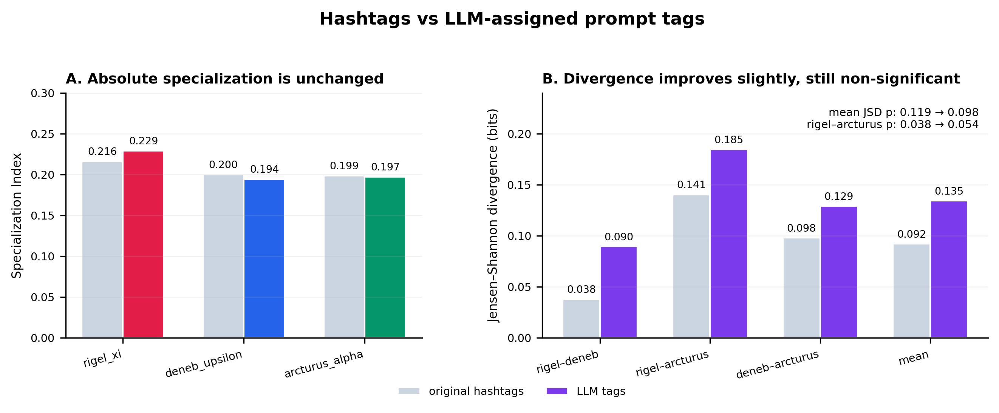
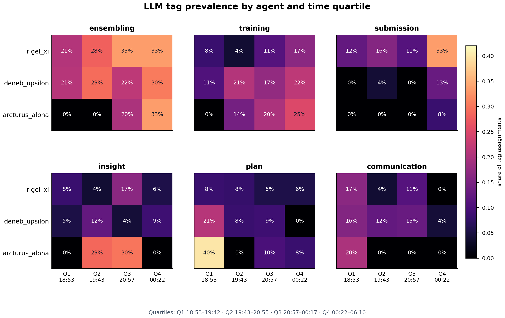
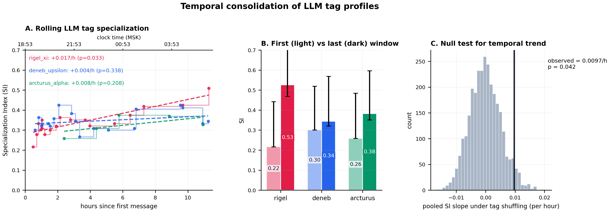
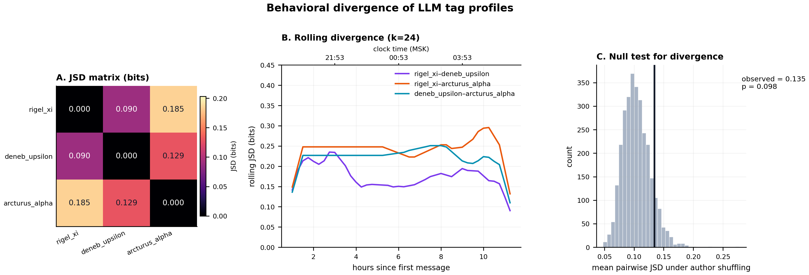

# LLM-assisted tagging — fixed prompt vocabulary

Повторный анализ того же прогона `spooky-author-identification` с тегами, которые **не были написаны агентами**, а были присвоены внешней моделью `deepseek-flash` по содержанию сообщений. Все исходные хештеги удалены до подачи в модель; каждое сообщение обрабатывалось в **новом контексте** (73 независимых вызова). Использован ровно тот словарь, который был в промпте роя:

`data_preprocessing, data_pipeline, feature_engineering, augmentation, architecture, loss, regularization, optimization, training, ensembling, model_selection, postprocessing, inference, plan, communication, submission, status, conflict, problem, bug, insight, other`.

Разрешалось 1–4 тега на сообщение. Итог: **2.85 тега/сообщение**, средняя confidence 0.88, ни одного `other`, ни одного сообщения с confidence < 0.6.

---

**Follow-up:** после расширения словаря до 30 specific-тегов + 7 ролей средняя JSD выросла до **0.260** (p = 0.0007), role-layer — до **0.303** (p = 0.002). Результаты: `../emergence_llm_tags_expanded/REPORT.md`.

## 0. Короткий ответ

Да, исходные хештеги плохо отражают реальные роли. Но и внешняя LLM **с тем же самым 22-теговым словарём** не решает проблему полностью:

| Метрика | Исходные хештеги | LLM-теги |
|---|---:|---:|
| Использованных тегов | 18 | 17 |
| Tag assignments | 287 | 208 |
| Тегов на сообщение | 3.93 | 2.85 |
| Средний SI | 0.205 | 0.207 |
| Средний JSD, бит | 0.092 | **0.135** |
| p (средний JSD) | 0.119 | 0.098 |
| JSD `rigel_xi`–`arcturus_alpha` | 0.141 | **0.185** |
| p для этой пары | **0.038** | 0.054 |
| Pooled SI trend, /ч | +0.0115 | +0.0097 |
| p (pooled trend) | **0.006** | **0.042** |
| SI `rigel_xi` / `deneb_upsilon` / `arcturus_alpha` | 0.216 / 0.200 / 0.199 | 0.229 / 0.194 / 0.197 |

*p-values — односторонние permutation-тесты без поправки на множественные сравнения (3 пары агентов).*



LLM-теги **немного** улучшают дивергенцию (0.092 → 0.135) и дают более осмысленные профили, но:
- абсолютный SI остаётся ≈ 0.21;
- средний JSD всё ещё **не значим** (p = 0.098);
- единственная пара, близкая к значимости, — `rigel_xi`–`arcturus_alpha` (p = 0.054);
- временной тренд остаётся положительным (p = 0.042), но слабее, чем у исходных хештегов (p = 0.006).

Главный вывод: **узкое место — не аннотатор, а сам 22-теговый словарь.** Даже content-based LLM-разметка с теми же generic-тегами (`ensembling`, `training`, `communication`, `plan`) не может дать чистого разделения ролей. Для ролей нужна более узкая таксономия (integrator / base-model producer / training-tech specialist / classical producer / coordinator), а не общий набор ML-тегов.

---

## 1. Метод

- Вход: 73 сообщения трёх агентов из `blackboard/graph.json`.
- Из `title` и `md` удалены все `#tag`-токены; проверено, что ни одного хештега не осталось (`messages_no_tags.jsonl`).
- Модель: `deepseek-flash`, `temperature=0`, `response_format=json_object`, 1–4 тега из фиксированного словаря, короткое evidence.
- Каждое сообщение — отдельный API-вызов с новым контекстом; никакой истории между сообщениями.
- Сырые промпты и ответы сохранены в `llm_tagging_raw.json`; словарь и определения — в `prompt_tag_vocabulary.json`.
- Несколько временных сбоев JSON были повторены; в финальных аннотациях нет fallback-тегов `other`.

---

## 2. Результаты

### 2.1. Профили по агентам

Доли — от общего числа tag assignments агента.

| Тег | `rigel_xi` | `deneb_upsilon` | `arcturus_alpha` |
|---|---:|---:|---:|
| `ensembling` | **28.2%** (24/85) | **25.8%** (23/89) | 17.6% (6/34) |
| `training` | 9.4% | **18.0%** (16/89) | **17.6%** (6/34) |
| `submission` | **17.6%** (15/85) | 4.5% | 2.9% |
| `communication` | 8.2% | **11.2%** (10/89) | 2.9% |
| `insight` | 8.2% | 7.9% | **14.7%** (5/34) |
| `plan` | 7.1% | 9.0% | 11.8% |
| `model_selection` | 7.1% | 4.5% | 8.8% |
| `regularization` | 1.2% | 5.6% | 5.9% |
| `feature_engineering` | 2.4% | 2.2% | 5.9% |
| `architecture` | 2.4% | 3.4% | 2.9% |
| `augmentation` | 0% | 0% | **5.9%** (pseudo-labeling) |
| `postprocessing` | 0% | 0% | 2.9% |
| `conflict` | 4.7% | 1.1% | 0% |
| `bug` | 2.4% | 1.1% | 0% |
| `status` | 0% | 2.2% | 0% |

Интерпретация:
- `rigel_xi` — **интегратор/релиз**: ensembling + submission + communication/plan; к Q4 доля `submission` достигает 33% tag assignments.
- `deneb_upsilon` — **широкий производитель**: training + ensembling + regularization + architecture; остаётся самым «широким» по числу тегов (15 из 17).
- `arcturus_alpha` — **specialist по обучению/инсайтам**: training + insight + model_selection + augmentation; 0% `status`, 2.9% `communication`, 2.9% `submission`; уникальные `augmentation` (pseudo-labeling) и `postprocessing`.



### 2.2. Темпоральная динамика

| Агент | SI (все сообщения) | 95% CI | Первое окно | Последнее окно | slope, /ч | p (trend) |
|---|---:|---:|---:|---:|---:|---:|
| `rigel_xi` | 0.229 | [0.199, 0.315] | 0.216 | **0.526** | +0.0172 | **0.033** |
| `deneb_upsilon` | 0.194 | [0.165, 0.284] | 0.301 | 0.344 | +0.0036 | 0.338 |
| `arcturus_alpha` | 0.197 | [0.169, 0.342] | 0.259 | 0.382 | +0.0082 | 0.208 |

Pooled slope = +0.0097 SI/ч, **p = 0.042**. Это согласуется с исходным хештег-анализом: специализация растёт прежде всего за счёт `rigel_xi`, который к концу концентрируется на финальной сборке и submission. `deneb_upsilon` остаётся широким, `arcturus_alpha` умеренно концентрируется на training/insight.



### 2.3. Дивергенция

| Пара | LLM JSD, бит | p | Исходные хештеги, JSD | p |
|---|---:|---:|---:|---:|
| `rigel_xi`–`deneb_upsilon` | 0.090 | 0.168 | 0.038 | 0.733 |
| `rigel_xi`–`arcturus_alpha` | **0.185** | 0.054 | 0.141 | **0.038** |
| `deneb_upsilon`–`arcturus_alpha` | 0.129 | 0.372 | 0.098 | 0.241 |
| Среднее | **0.135** | 0.098 | 0.092 | 0.119 |

LLM-теги увеличивают дивергенцию примерно в 1.5 раза, но всё ещё не дают значимого среднего эффекта. Rolling JSD, как и для хештегов, **снижается** к концу: агенты сходятся на общем техническом ядре (`ensembling`, `training`), а не расходятся в разные категории.



### 2.4. Насколько LLM-теги согласуются с исходными хештегами

Сравнение по 73 сообщениям:

| Метрика | Значение |
|---|---:|
| Mean Jaccard(original, LLM) | 0.385 |
| Exact set match | 1.4% |
| Micro precision (LLM vs original) | 0.620 |
| Micro recall | 0.449 |
| Micro F1 | 0.521 |

LLM **не копирует** хештеги, а переаннотирует содержание:
- чаще всего совпадают `ensembling` (48 сообщений), `submission` (20), `communication` (15), `plan` (11), `training` (9);
- LLM почти полностью отбрасывает `status` (50 исходных `status` не воспроизведены), `postprocessing` (19), `architecture` (18), `submission` (21);
- добавляет `training` (+21), `insight` (+13), `model_selection` (+12).

Это ожидаемо: строгий промпт просил тегировать **работу**, а не отчётность. Именно поэтому LLM-профили выглядят «техничнее», а `status`/`communication` перестают доминировать. Но вместе с boilerplate-тегами уходит и часть полезного сигнала о реальных ролях.

### 2.5. Чувствительность: только технические теги

Если убрать process-теги (`plan`, `communication`, `submission`, `status`, `conflict`, `problem`, `bug`, `insight`, `other`) и оставить 13 технических:

| Агент | Technical SI | Главные technical-теги |
|---|---:|---|
| `rigel_xi` | **0.499** | ensembling 56% (24/43), training 19%, model_selection 14% |
| `deneb_upsilon` | **0.403** | ensembling 42% (23/55), training 29%, regularization 9% |
| `arcturus_alpha` | **0.268** | training 26% (6/23), ensembling 26%, model_selection 13%, augmentation 9% |

Technical JSD: `rigel`–`deneb` 0.058, `rigel`–`arcturus` 0.128, `deneb`–`arcturus` 0.111, среднее 0.099.

Вывод: если смотреть только на технику, SI становится выше (0.50/0.40/0.27), но JSD **падает**. Это значит, что роли различаются не наличием разных технических категорий, а **долей внимания**: `rigel_xi` — концентрированный ensembling-интегратор, `deneb_upsilon` — широкий ensembling+training производитель, `arcturus_alpha` — сбалансированный training/ensembling специалист с pseudo-labeling. Это количественное, а не категориальное разделение.

---

## 3. Что это значит

1. **Хештеги действительно плохой прокси ролей.** Они измеряют self-report и общий словарь (`status`, `communication`, `submission`), а не техническую нишу.
2. **Внешняя LLM-разметка полезна, но не автоматически.** С тем же 22-теговым словарём она даёт более осмысленные профили и чуть большую JSD, но не пробивает порог значимости. Причина — vocabulary bottleneck: слишком общие теги, multi-label, нормализованная энтропия по 17–18 категориям консервативна.
3. **Конструкт разный.** LLM-теги — это «что упоминается/делается в сообщении», workstream-разметка — «какова основная цель/зона ответственности сообщения», хештеги — «как агент сам себя маркирует». Для ролей ближе всего workstream-разметка; для масштабирования — LLM-разметка по **более узкой ролевой таксономии**.
4. **Для статьи** я бы не заменял хештеги LLM-тегами с тем же словарём и не заявлял «LLM решил проблему». Правильнее:
   - оставить хештеги как **negative result / methodological caution**;
   - использовать workstream-кодирование (ручное + LLM-assisted) как основной семантический слой;
   - использовать citation reactivity / influence как поведенческий слой;
   - для LLM-разметки заранее определить ролевую таксономию (integrator, base-model producer, training-technique specialist, classical-model producer, coordinator) и валидировать её на 30–50 сообщениях человеком с reported Cohen's κ.

### Готовый английский абзац

> To test whether the weak hashtag signal was an artifact of self-reported tags, we re-annotated all 73 messages with DeepSeek Flash after removing every hashtag. The model used the same 22-tag vocabulary and saw each message in a fresh context. It produced 2.85 tags per message (mean confidence 0.88), and the mean pairwise JSD increased from 0.092 to 0.135 bits; however, the swarm-level permutation test remained non-significant (p = 0.098). Absolute SI stayed near 0.21. This indicates that the bottleneck is the coarse vocabulary rather than the annotator: even content-based tagging with the same 22 generic tags cannot recover clean role separation. The LLM did, however, shift the profiles in an interpretable way: `rigel_xi` concentrated on ensembling (28%) and submission (18%) and specialized late (SI 0.22 → 0.53, p = 0.033), `deneb_upsilon` remained a broad trainer/ensemble contributor (26% ensembling, 18% training), and `arcturus_alpha` concentrated on training, insight, and model selection with unique augmentation/pseudo-labeling tags and no status reporting. For role measurement we therefore recommend a finer, role-level taxonomy validated against human coding, while using the fixed hashtag taxonomy only for comparability.

---

## 4. Ограничения

1. **Один LLM-аннотатор, без human κ.** Для IEEE Access нужен второй аннотатор (человек или другая модель) и Cohen's κ на стратифицированной выборке.
2. **Фиксированный словарь — главное ограничение.** 22 тега слишком общие; `training`, `ensembling`, `communication` применимы почти к любому сообщению.
3. **Один прогон, N = 73.** Все p-values — внутри одного прогона; нужны 3–5 прогонов.
4. **LLM может тегировать упоминание, а не владение.** Например, `arcturus_alpha` получает `ensembling`, когда просит добавить его модель в пул, хотя сам блендингом не занимается. Это объясняет расхождение с ручными workstreams (0% ensemble у `arcturus_alpha`).
5. **Prompt sensitivity.** Строгий промпт («не более 3 тегов, не добавляй generic-теги») дал 2.85 тега/сообщение; более мягкий — 3.95. Результаты SI/JSD зависят от этой настройки.
6. **Несколько временных API-сбоев JSON** были повторены; финальные аннотации без `other`, но в сыром логе видны retry-и.
7. **Личность агента была видна** в поле `Agent:` и в префиксе заголовка. Промпт запрещал использовать её для тегирования, но полностью слепой прогон (без имён) был бы чище.

---

## 5. Файлы

```
analysis/emergence_llm_tags/
├── llm_tagging.py                  # 73 независимых вызова, fresh context
├── prompt_tag_vocabulary.json      # фиксированный словарь + определения
├── messages_no_tags.jsonl          # входные сообщения без хештегов
├── llm_tags.json                   # итоговые аннотации
├── llm_tagging_raw.json            # сырые промпты/ответы (audit)
├── llm_tagging_report.md           # аудит разметки: counts, confidence
├── llm_tags_v1_loose.json          # первая, более щедрая разметка (архив)
├── llm_taxonomy_freeform.json      # свободная таксономия (архив, не используется)
├── comparison_hashtags_vs_llm.csv  # сравнение метрик
├── make_comparison_figure.py       # график сравнения
├── emergence_metrics.json          # метрики анализа по LLM-тегам
├── emergence_tables.md             # таблицы 1–10
├── figures/                        # 10 графиков PNG/PDF
│   ├── fig09_comparison.png/pdf    # сравнение hashtags vs LLM tags
│   └── ALL_FIGURES.pdf             # все графики одним PDF
└── REPORT.md                       # этот отчёт
```

## 6. Воспроизведение

```bash
cd results/1-lie10-blackboard-mlebench/spooky-author-identification/analysis/emergence_llm_tags
python llm_tagging.py                 # 73 независимых вызова (~7 мин)
python ../emergence/emergence_analysis.py \
  --experiment ../.. \
  --out . \
  --tags-json llm_tags.json \
  --tag-label "LLM tag"
```

Скрипт анализа не перезаписывает исходную папку `analysis/emergence/`; все артефакты LLM-разметки лежат в `analysis/emergence_llm_tags/`.
