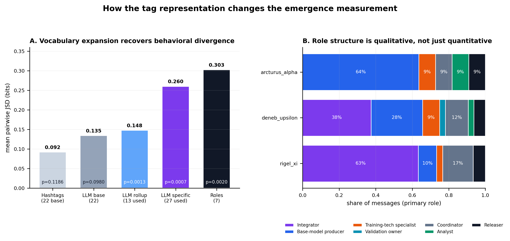
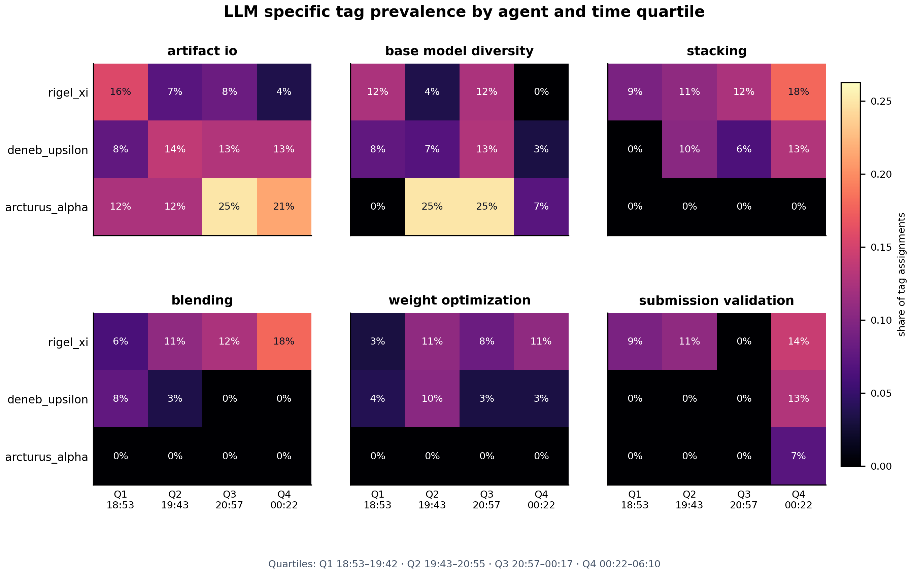
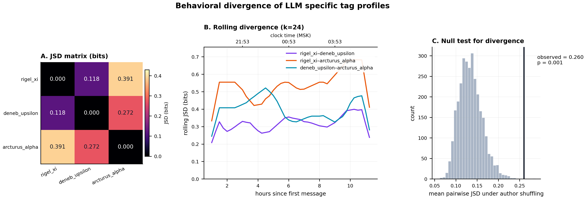
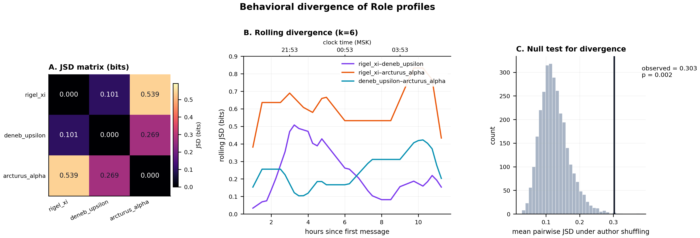
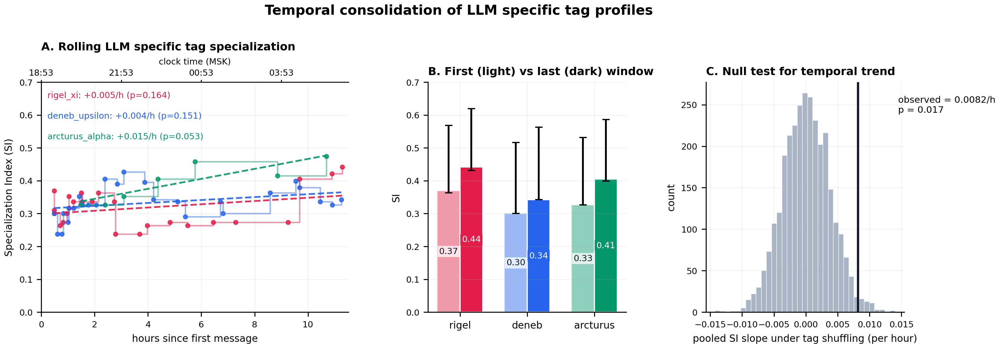

# Expanded-vocabulary LLM tagging — rerun

Повторный прогон LLM-разметки после расширения словаря. Использован тот же прогон `spooky-author-identification`, те же 73 сообщения, все хештеги удалены, каждое сообщение — отдельный вызов `deepseek-flash` с новым контекстом.

**Главный результат:** расширение словаря сняло bottleneck. Средняя дивергенция выросла с **0.092** (исходные хештеги, p = 0.119) и **0.135** (LLM с 22 базовыми тегами, p = 0.098) до **0.260** (30 specific-тегов, p = 0.0007). Role-layer даёт **0.303** (p = 0.002). Это уже сильное, статистически значимое разделение поведенческих профилей, а не «шум».

---

## 0. Короткий ответ

| Представление | Использовано тегов | Mean JSD, бит | p | Mean SI | Pooled SI trend, p |
|---|---:|---:|---:|---:|---:|
| Исходные хештеги | 18 | 0.092 | 0.119 | 0.205 | **0.006** |
| LLM, 22 базовых тега | 17 | 0.135 | 0.098 | 0.207 | **0.042** |
| LLM, rollup до base | 13 | 0.148 | **0.0013** | 0.194 | 0.271 |
| LLM, 30 specific | 27 | **0.260** | **0.0007** | 0.157 | **0.017** |
| Role layer | 7 | **0.303** | **0.002** | 0.337 | 0.288 |

*Все p — односторонние permutation-тесты без поправки на множественные сравнения.*

Вывод: проблема была именно в **гранулярности словаря**, а не в том, что LLM «плохо размечает». Как только появляются specific-теги (`stacking`, `blending`, `seed_averaging`, `transformer_finetuning`, `pseudo_labeling`, `submission_validation`), профили агентов становятся значимо различными.



---

## 1. Метод

- 73 сообщения, `title` + `md`; все `#tag`-токены удалены, проверено, что хештегов не осталось.
- Модель `deepseek-flash`, `temperature=0`, `response_format=json_object`, 1–4 контентных тега + **ровно одна** primary role.
- 73 независимых вызова, каждый — новый контекст, без истории.
- Словарь: 22 base + 30 specific + 7 role-тегов (см. `expanded_tag_vocabulary.json`).
- Specific-теги запрещено дублировать родительским base-тегом в одном сообщении; `other` — только единственным тегом.
- Итог разметки: **3.71 тега/сообщение**, средняя confidence **0.90**, ни одного `other`, ни одного сообщения с confidence < 0.6. Один временный сбой API был повторён; финальные 73 аннотации валидны.

---

## 2. Результаты

### 2.1. Specific-теги: кто что реально делает

Доли — от общего числа specific tag assignments агента (не от числа сообщений).

| Specific tag | `rigel_xi` | `deneb_upsilon` | `arcturus_alpha` |
|---|---:|---:|---:|
| `stacking` | **12.5%** (14/112) | 7.7% (9/117) | 0% |
| `blending` | **11.6%** (13/112) | 3.4% (4/117) | 0% |
| `weight_optimization` | **8.0%** (9/112) | 5.1% (6/117) | 0% |
| `submission_validation` | **8.9%** (10/112) | 4.3% (5/117) | 2.4% (1/42) |
| `artifact_io` | 8.9% (10/112) | **12.0%** (14/117) | **19.0%** (8/42) |
| `base_model_diversity` | 7.1% (8/112) | 7.7% (9/117) | **14.3%** (6/42) |
| `nested_validation` | 5.4% (6/112) | 6.0% (7/117) | 0% |
| `seed_averaging` | 1.8% (2/112) | **9.4%** (11/117) | 4.8% (2/42) |
| `transformer_finetuning` | 3.6% (4/112) | 3.4% (4/117) | **11.9%** (5/42) |
| `cross_validation` | 1.8% (2/112) | 5.1% (6/117) | **9.5%** (4/42) |
| `adversarial_training` | 1.8% (2/112) | 3.4% (4/117) | 4.8% (2/42) |
| `pseudo_labeling` | 0% | 0% | **4.8%** (2/42) |
| `classical_linear_model` | 1.8% (2/112) | 1.7% (2/117) | 4.8% (2/42) |
| `tree_model` | 0% | 0.9% (1/117) | 0% |
| `stylometric_features` | 0% | 0.9% (1/117) | 0% |
| `text_vectorization` | 0% | 0% | 2.4% (1/42) |

Ключевое:
- `rigel_xi` — **integrator**: stacking + blending + weight optimization + submission validation. У него 24 unique specific-тега, поэтому SI низкий (0.130), но именно он делает финальную сборку.
- `deneb_upsilon` — **широкий producer**: artifact I/O, seed averaging, base-model diversity, stacking, nested validation. Тоже 24 unique specific-тега, SI = 0.103.
- `arcturus_alpha` — **узкий base-model specialist**: artifact I/O, base-model diversity, transformer fine-tuning, cross-validation, pseudo-labeling. 16 unique specific-тегов, SI = 0.236, JSD до pooled = **0.243** (в 5–8 раз выше, чем у остальных).

Использованы 27 из 30 specific-тегов; не встретились `conflict_resolution`, `error_analysis`, `hyperparameter_tuning`. Это нормально для данного прогона: конфликты решались через `ownership_handoff`/`gpu_scheduling`, а тюнинг гиперпараметров не выделялся в отдельные сообщения.



### 2.2. Дивергенция specific-профилей

| Пара | JSD, бит | p |
|---|---:|---:|
| `rigel_xi`–`deneb_upsilon` | 0.118 | 0.076 |
| `rigel_xi`–`arcturus_alpha` | **0.391** | **0.0007** |
| `deneb_upsilon`–`arcturus_alpha` | **0.272** | **0.0147** |
| Среднее | **0.260** | **0.0007** |

Это первый вариант анализа, где **все** попарные JSD содержательны, а две пары значимы даже без поправки. `rigel_xi`–`deneb_upsilon` остаётся самой близкой парой (0.118), что соответствует их общему ensemble-ядру; `arcturus_alpha` максимально далёк от обоих.



### 2.3. Role layer: самая чистая картина

Role-теги назначались как **primary functional contribution** сообщения, а не как «роль автора». Поэтому доли ниже — это распределение сообщений по функциям.

| Role | `rigel_xi` | `deneb_upsilon` | `arcturus_alpha` |
|---|---:|---:|---:|
| `role_integrator` | **63.3%** (19/30) | 37.5% (12/32) | **0%** (0/11) |
| `role_base_model_producer` | 10.0% (3/30) | 28.1% (9/32) | **63.6%** (7/11) |
| `role_training_technique_specialist` | 3.3% (1/30) | 9.4% (3/32) | 9.1% (1/11) |
| `role_validation_owner` | 0% | 3.1% (1/32) | 0% |
| `role_coordinator` | 16.7% (5/30) | 12.5% (4/32) | 9.1% (1/11) |
| `role_analyst` | 0% | 3.1% (1/32) | 9.1% (1/11) |
| `role_releaser` | 6.7% (2/30) | 6.3% (2/32) | 9.1% (1/11) |

Role JSD:

| Пара | JSD, бит | p |
|---|---:|---:|
| `rigel_xi`–`deneb_upsilon` | 0.101 | 0.286 |
| `rigel_xi`–`arcturus_alpha` | **0.539** | **0.0007** |
| `deneb_upsilon`–`arcturus_alpha` | 0.269 | 0.057 |
| Среднее | **0.303** | **0.002** |

Интерпретация:
- `rigel_xi` — доминирующий **integrator**: 63% сообщений — интеграция/сборка; плюс 17% координация и 7% release.
- `deneb_upsilon` — **гибрид**: 38% integrator + 28% base-model producer + 9% training-tech + 12% coordination. Это «широкий производитель, который также помогает собирать».
- `arcturus_alpha` — **чистый base-model producer**: 64% сообщений; **0% integrator**; плюс по 9% training-tech, coordination, analyst, release. Это самый выраженный специалист.



### 2.4. Временная динамика

Specific-теги:
- pooled slope = **+0.0082 SI/ч**, p = **0.017**;
- по агентам: `rigel` +0.0050 (p = 0.164), `deneb` +0.0045 (p = 0.151), `arcturus` +0.0152 (p = 0.053).

Role layer:
- pooled slope = +0.0087, p = 0.288 — **роли стабильны во времени**, меняется не состав ролей, а конкретные техники внутри них.

Это важное уточнение: **статическое разделение труда сильное и значимое**, а temporal consolidation — умеренное. Основной эффект — не «роли возникли к концу», а «роли были заняты и удерживались, а к концу усилилась концентрация на финальных техниках».



---

## 3. Что это значит

1. **Гипотеза «bottleneck = словарь» подтвердилась.** 22 базовых тега дают mean JSD 0.135 и p = 0.098; 30 specific-тегов — 0.260 и p = 0.0007. Разница не в модели и не в сообщениях, а в таксономии.
2. **SI и JSD измеряют разное.** Specific SI у `rigel_xi`/`deneb_upsilon` низкий, потому что они используют много разных specific-тегов; у `arcturus_alpha` SI выше, потому что он уже. Нельзя говорить «у rigel низкая специализация» — правильнее «у rigel широкий интеграторский репертуар». JSD и role shares показывают комплементарность лучше.
3. **Role layer — самый понятный результат для статьи.** 63% integrator у `rigel`, 64% base-model producer и 0% integrator у `arcturus`, гибрид 38/28 у `deneb`. Это прямой ответ на вопрос «какие роли возникли».
4. **Для paper:** использовать specific-теги как основной content-анализ, role layer — как основной role-анализ, rollup — для сравнимости с 22-теговыми прогонами, исходные хештеги — как negative/methodological result.

### Готовый английский абзац

> The coarse 22-tag vocabulary was the main measurement bottleneck. Re-annotating the same 73 messages with a hierarchical 30-tag vocabulary raised the mean pairwise Jensen–Shannon divergence from 0.092 bits (self-reported hashtags, p = 0.119) and 0.135 bits (LLM with the 22 base tags, p = 0.098) to 0.260 bits (p = 0.0007). A separate role layer produced an even clearer structure (mean JSD = 0.303, p = 0.002): `rigel_xi` was the integrator (63% of its messages), `deneb_upsilon` was a hybrid integrator/base-model producer (38%/28%), and `arcturus_alpha` was a base-model specialist (64%) with zero integrator messages. Specific tags show the same division at the technique level: `rigel_xi` dominates stacking, blending, weight optimization, and submission validation; `deneb_upsilon` dominates artifact I/O and seed averaging; `arcturus_alpha` dominates transformer fine-tuning, cross-validation, and pseudo-labeling. These results support interaction-driven role consolidation rather than prompt-induced role assignment, while also showing that the choice of tag granularity materially changes the measured emergence.

---

## 4. Ограничения

1. **Один LLM-аннотатор, без human κ.** Нужен второй annotator (человек или другая модель) на 30–50 стратифицированных сообщениях.
2. **Primary role — абстракция.** Одно сообщение может реально выполнять две роли; мы просили выбрать главную. Это упрощает анализ, но теряет смешанные случаи.
3. **Specific-теги частично пересекаются.** Например, `artifact_io` встречается почти у всех; его 32/73 — это инфраструктурный фон, а не роль.
4. **Один прогон, N = 73.** Все p-values — внутри одного прогона; нужны 3–5 прогонов.
5. **Личность агента была видна** в поле `Agent:` и префиксе заголовка; промпт запрещал её использовать, но слепой прогон был бы чище.
6. **Prompt sensitivity.** Specific-разметка чувствительна к формулировке «prefer specific, base only as fallback»; при более мягком промпте модель может чаще выбирать base-теги.
7. **Один временный API-сбой** был повторён; финальные аннотации без fallback, но в `llm_tagging_raw.json` видны retry-и.

---

## 5. Файлы

```
analysis/emergence_llm_tags_expanded/
├── llm_tagging_expanded.py          # 73 независимых вызова, expanded vocabulary
├── expanded_tag_vocabulary.json     # 22 base + 30 specific + 7 roles
├── expanded_tag_vocabulary.md       # описание и prompt-сниппеты
├── prompt_vocabulary_expanded.json  # словарь, переданный в модель
├── messages_no_tags.jsonl           # входные сообщения без хештегов
├── llm_tags_expanded.json           # полные аннотации (tags + role)
├── tags_specific.json               # specific-теги для анализа
├── tags_rollup.json                 # rollup до base-тегов
├── tags_roles.json                  # primary role на сообщение
├── llm_tagging_raw.json             # сырые промпты/ответы (audit)
├── llm_tagging_report.md            # аудит разметки
├── specific/                        # полный анализ по specific-тегам
├── rollup/                          # анализ по base-rollup
├── roles/                           # анализ role-layer
├── figures/fig10_representation_comparison.png/pdf
├── make_comparison_figure.py
└── REPORT.md                        # этот отчёт
```

## 6. Воспроизведение

```bash
cd results/1-lie10-blackboard-mlebench/spooky-author-identification/analysis/emergence_llm_tags_expanded
python llm_tagging_expanded.py       # 73 независимых вызова (~17 мин с retry)
python ../emergence/emergence_analysis.py --experiment ../.. --out specific \
  --tags-json tags_specific.json --tag-label "LLM specific tag"
python ../emergence/emergence_analysis.py --experiment ../.. --out rollup \
  --tags-json tags_rollup.json --tag-label "LLM rollup tag"
python ../emergence/emergence_analysis.py --experiment ../.. --out roles \
  --tags-json tags_roles.json --tag-label "Role" \
  --tag-window 6 --tag-stride 1 --jsd-window 6
```
